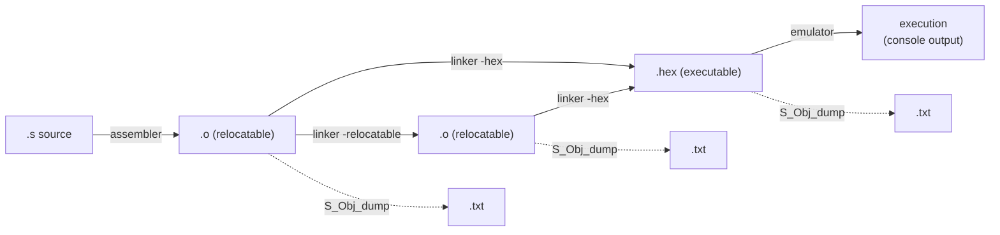
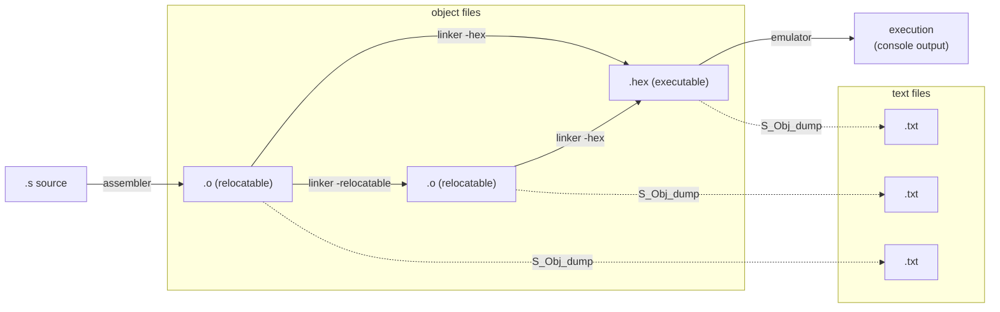
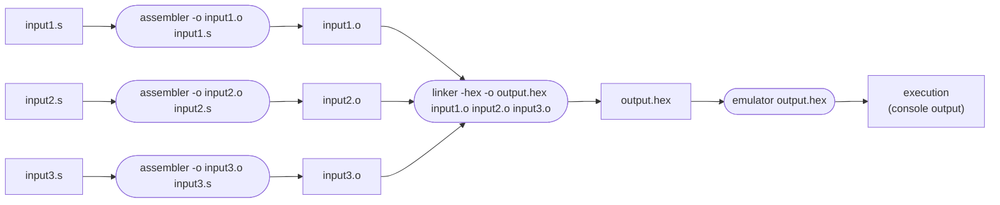
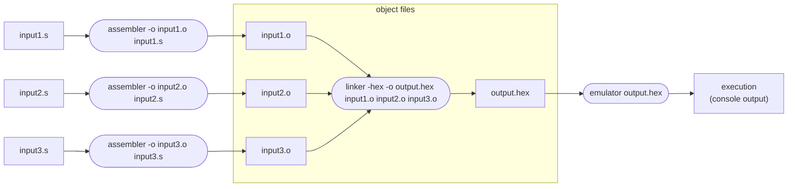

# System Software Project


_A toolchain for an abstract computer system comprising an assembler, linker, emulator, and disassembler._

_S\_CS (Školski Računarski Sistem) is a 32-bit, two-address, Von Neumann architecture computer system._

## Table of Contents

- [Overview](#overview)
- [Building](#building)
- [Usage](#usage)
  - [Assembler](#assembler)
  - [Linker](#linker)
  - [Emulator](#emulator)
  - [S_Obj_dump](#s_obj_dump)
- [Architecture](#architecture)
- [Object File Format](#object-file-format)
- [Supported features](#suported-features)
  - [CPU instruction set](#cpu-instruction-set)
  - [Instruction adderssing](#instruction-addressing)
  - [Assembly language](#assembly-language)
  - [Terminal](#terminal)
  - [Timer](#timer)
- [Examples](#examples)

## Overview

This project implements a complete translation toolchain and emulator for the
S_CS abstract computer system. A user program is written in assembly, translated
to a relocatable object file by the assembler, combined and placed in memory by
the linker, and executed by the emulator. The disassembler can inspect any
object or executable file produced along the way.

The flow through the toolchain is:


<details>
<summary>better graph (broken on github)</summary>


</details><br>

***Common usage:*** assembling, linking and running multiple files that define a single program



<details>
<summary>better graph (broken on github)</summary>



</details><br>

The four tools are:

- **assembler** — a single-pass assembler that translates one assembly source
  file into a relocatable object file, emitting machine code, a symbol table,
  and relocation records.
- **linker** — a target-independent linker that merges one or more object files,
  resolves relocations, and produces either an executable memory image (`-hex`)
  or a relocatable object file (`-relocatable`) that can be linked again.
- **emulator** — an interpretive emulator that loads an executable, simulates the
  S_CS processor and its peripherals, and runs the program until a `halt`
  instruction.
- **S_Obj_dump** — a disassembler that reads object and executable files and
  prints their sections, symbol table, relocations, and disassembled
  instructions.

## Building

Prerequisites: a C compiler (gcc), `flex`, and `bison`. Targets Linux (amd64).

Build all tools:

```bash
make
```

This produces the `assembler`, `linker`, `emulator`, and `S_Obj_dump` binaries and immediately copies them to the local/bin/ directory.

If you want to build and leave the binaries in the CWD use:

```bash
make allDebug
```


For a quick cleanup of all of the produced .txt, .o and .hex files use:

```bash
make cleanFiles
```
## Usage

### Assembler

A single-pass assembler that produces relocatable S_ELF binaries.

Usage:

```
assembler [options] <input_file>
```

**Options:**

- `-o <output_file>` — write output to a specific file

**Example:**

```
assembler -o output.o input.s
```

### Linker

A basic S_ELF binary linker. It merges one or more object files and resolves
their relocations, producing either an executable or a relocatable object file.

Usage:

```
linker [options] <input_file>...
```

**Options:**

- `-hex` — produce an executable S_ELF file
- `-relocatable` — produce a relocatable S_ELF file (can be linked again)
- `-o <output_file>` — write output to a specific file
- `-place=<section_name>@<address>` — place a section at a specific address
  (executable output only)

**Example:**

```sh
linker -hex \
  -place=text@0x40000000 \
  -place=data@0x4000F000 \
  -o mem_content.hex \
  input1.o input2.o
```

### Emulator

Executes an S_ELF executable file (the `-hex` output of the linker), simulating
the S_CS processor and its peripherals. The only console output during execution
comes from the user program itself. On a `halt` instruction the emulator stops
and prints the final processor state.

Usage:

```
emulator <input_file.hex>
```

### S_Obj_dump

A disassembler that inspects both relocatable (`.o`) and executable (`.hex`)
S_ELF files. It prints the section table, symbol table, relocation records, and
the disassembled instructions of each section.

Usage:

```
S_Obj_dump <input_file>
```

## Architecture

S_CS is a 32-bit, two-address, Von Neumann architecture system with a byte-
addressable, little-endian, 2^32-byte address space. Connected to the system are two peripherals in a form of an terminal and a timer.

After reset the processor
begins executing at address `0x40000000`.

**Registers.** Sixteen 32-bit general-purpose registers `r0`–`r15`. `r0` is hard-
wired to zero. `r15` is the program counter (`pc`) and holds the address of the
next instruction to execute. `r14` is the stack pointer (`sp`); the stack grows
toward lower addresses. Three control and status registers exist: `status`
(processor status word), `handler` (interrupt routine address), and `cause`
(interrupt cause).

**Instruction format.** Every instruction is four bytes:

| Byte 0 | Byte 1 | Byte 2 | Byte 3 |
|:---:|:---:|:---:|:---:|
| OC (bits 31–28) \| MOD (27–24) | RegA (23–20) \| RegB (19–16) | RegC (15–12) \| Disp[11:8] | Disp[7:0] |

`OC` is the operation code, `MOD` the instruction modifier, `RegA`/`RegB`/`RegC`
register indices, and `Disp` a signed 12-bit displacement.

**Interrupts.** 

A single interrupt routine is used, its address held in `handler`.

On accepting an interrupt the processor pushes the status word and the return
address onto the stack (in that order) and globally masks interrupts.

The value of the `cause`
register identifies the source:

1. an invalid instruction
2. the timer
3. the terminal
4. a software interrupt.

Interrupt masking is handled by the `status` register, which has 3 flags
(`0` = allowed, `1` = masked):
|  15  |  14  |  13  |  12  |  11  |  10  |  9  |  8  |  7  |  6  |  5  |  4  |  3  |   2   |   1   |   0   |
|:---:|:---:|:---:|:---:|:---:|:---:|:---:|:---:|:---:|:---:|:---:|:---:|:---:|:---:|:---:|:---:|
|     |     |     |     |     |     |     |     |     |     |     |     |     |   I   |   Tr   |   Tm   |

- **bit 0** — timer (Tm) masking
- **bit 1** — terminal (Tr) masking
- **bit 2** — global (I) masking

**Peripherals.** Memory-mapped registers occupy the 256-byte region starting at
`0xFFFFFF00`:

- `term_out` (`0xFFFFFF00`) — writing a value displays the corresponding ASCII
  character.
- `term_in` (`0xFFFFFF04`) — holds the ASCII code of the last key pressed; a
  keypress also raises a terminal interrupt.
- `tim_cfg` (`0xFFFFFF10`) — timer period configuration; the timer periodically
  raises an interrupt.


## Object File Format

The object and executable files use S_ELF (Školski ELF), a custom variant of the ELF
format. Each file begins with an 8-byte signature. A relocatable object marks
its section header table offset in the header, while an executable marks its
segment table offset instead, which distinguishes the two kinds of file.

Usual convetion and the default behaviour of the linker is that relocatable object files have an extension `.o` while executable object files have an extension `.hex`.

A relocatable object contains the section contents followed by four metadata
sections + 2 string litearl pools: 

- a symbol string pool (contains symbol names in a null terminated ASCII format)
- the symbol table (fixed-size entries holding name offset, value, size, type, binding, and section)
- the relocation table (fixed-size entries holding section, symbol, offset, addend, and type)
- a section string pool  (contains section names in a null terminated ASCII format)
- The section header table lists every section with its name, length,and base offset.

An executable object contains the segment contents followed by its own `__sym__table__` and ended:

- a symbol metadata string pool (contains symbol names in a null terminated ASCII format)
- the symbol metadata segment (fixed-size entries holding address, size, type, and name. used by the S_Obj_dump for displaying purposes unused by the emulator)
- The segment header table lists every segment with its load address, size in bytes and its offset within the file

Because the instruction displacement field is only 12 bits but addresses are 32
bits, symbols and large literals cannot be embedded directly in an instruction.
Instead the linker builds a dedicated `__sym_table__` section of 4-byte slots,
each holding a full 32-bit address. An instruction that references a far symbol
holds a 12-bit PC-relative offset to its slot; at runtime it reads the slot to
obtain the full address. The linker deduplicates slots so that references
resolving to the same address share one slot.

## Suported features

### CPU instruction set
### Instruction adderssing
### Assembly language
### Terminal
### Timer

## Examples

The following example mirrors the program from the project specification. It is
split across `handler.s` and `main.s`: the program installs an interrupt handler,
prints a character on a terminal interrupt, prints `T` on a timer interrupt,
configures the timer to fire every second, and halts after five keypresses.

Assemble both sources, link them into an executable with explicit section
placement, and run it:

**Shell:**
```sh
assembler -o handler.o handler.s
assembler -o main.o main.s
linker -hex \
  -place=my_code_main@0x40000000 \
  -place=my_code_handler@0xC0000000 \
  -o program.hex handler.o main.o
emulator program.hex
```
**Source code:**
```
# file: handler.s
.equ term_out, 0xFFFFFF00
.equ term_in, 0xFFFFFF04
.equ ascii_code, 84   # ascii('T')
.extern my_counter
.global handler
.section my_code_handler
handler:
    push %r1
    push %r2
    csrrd %cause, %r1
    ld $2, %r2
    beq %r1, %r2, my_isr_timer
    ld $3, %r2
    beq %r1, %r2, my_isr_terminal
# obrada prekida od tajmera
my_isr_timer:
    ld $ascii_code, %r1
    st %r1, term_out
    jmp finish
# obrada prekida od terminala
my_isr_terminal:
    ld term_in, %r1
    st %r1, term_out
    ld my_counter, %r1
    ld $1, %r2
    add %r2, %r1
    st %r1, my_counter
finish:
    pop %r2
    pop %r1
    iret
.end
```
```
# file: main.s
.equ tim_cfg, 0xFFFFFF10
.equ init_sp, 0xFFFFFF00
.extern handler
.section my_code_main
    ld $init_sp, %sp
    ld $handler, %r1
    csrwr %r1, %handler
    ld $0x1, %r1
    st %r1, tim_cfg
wait:
    ld my_counter, %r1
    ld $5, %r2
    bne %r1, %r2, wait
    halt
.global my_counter
.section my_data
my_counter:
    .word 0
.end

```